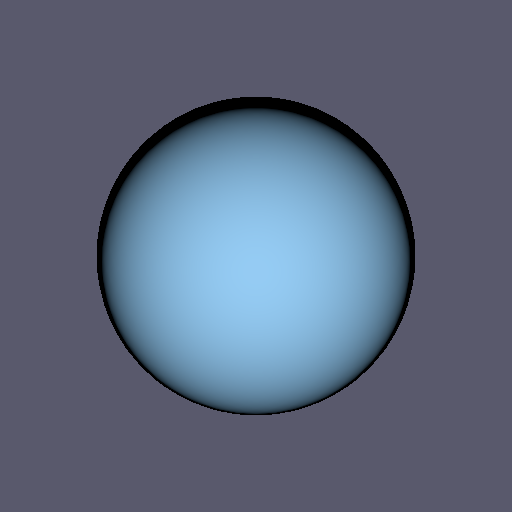

```{r setup, include = FALSE}
knitr::opts_chunk$set(collapse = TRUE, comment = "#>")
options(width = 80)
```

# frustumR

*3D rendered straight to a file*

<!-- badges: start -->
[](https://github.com/gcol33/frustumR/actions/workflows/R-CMD-check.yaml)
[](https://app.codecov.io/gh/gcol33/frustumR)
[](https://opensource.org/licenses/MIT)
<!-- badges: end -->

frustumR renders scientific 3D figures, such as isosurfaces, triangle meshes, point clouds and lines, on the GPU and writes them to PNG files without opening a window.

You build a scene in R from a camera, geometry, materials and a light. A Rust backend draws it off-screen with [wgpu](https://wgpu.rs/), which runs on Vulkan, Metal or DX12, and returns the PNG bytes. No display server or OpenGL context is involved, so the same script runs on a laptop, a headless server, a Docker image or a continuous-integration job, and you decide where the figure is written.

frustumR supports:

- **Isosurfaces from volumes.** `marching_cubes()` extracts the surface at one value of a 3D scalar field on a regular grid, and `marching_cubes_multi()` extracts several nested surfaces in one call.
- **Meshes, point clouds and lines.** Triangle meshes come from `mesh_new()` or marching cubes, point clouds from `pointcloud_new()` and connected line segments from `polyline_new()`.
- **Colour mapping.** `material_scalar_mapped()` maps a value per vertex through the viridis, plasma, magma, inferno or cividis colour map, so a field on a surface becomes colour.
- **Rendering without a display.** `render_to_png()` returns the PNG bytes, and `fr_render()` writes them to a file.

## Installation

frustumR compiles a Rust library. Install the build tools for your operating system first:

| Operating system | Build tools |
|---|---|
| Windows | [Rtools](https://cran.r-project.org/bin/windows/Rtools/), the version that matches your R version |
| macOS | Run `xcode-select --install` in Terminal |
| Debian / Ubuntu | Install `r-base-dev` |

Then install the Rust toolchain (`cargo` and `rustc` 1.85.0 or later) from [rustup.rs](https://rustup.rs/). On Windows, add the GNU target that the package links with:

```sh
rustup target add x86_64-pc-windows-gnu
```

Check that R can find the compiler:

```r
pkgbuild::has_build_tools(debug = TRUE)
```

Then install frustumR:

```r
# install.packages("pak")
pak::pak("gcol33/frustumR")
```

The installer stops with a message when it cannot find `cargo`. Rendering needs a GPU with Vulkan, Metal or DX12 support.

## Usage

1. Build the geometry, here a sphere as a volume with `sphere_volume()` and its surface with `marching_cubes()`.
2. Set up a scene with `scene_new()`, then add a light, the mesh and its material.
3. Render the scene to a PNG file with `fr_render()`.

```{r usage}
library(frustumR)

vol  <- sphere_volume()
mesh <- marching_cubes(vol, iso_value = 0)
mesh <- mesh_with_material(mesh, "shell")

cam   <- camera_perspective(c(2, 1.5, 2), c(0, 0, 0), fov_degrees = 45)
scene <- scene_new(cam, c(-1, -1, -1), c(1, 1, 1))
scene <- scene_set_light(scene, light_three_quarter())
scene <- scene_add_mesh(scene, mesh)
shell <- material_solid("shell", c(0.3, 0.6, 0.9))
scene <- scene_add_material(scene, shell)

fr_render(scene, "sphere.png")
```

```{r usage-figure, include = FALSE}
dir.create("man/figures", showWarnings = FALSE, recursive = TRUE)
file.copy("sphere.png", "man/figures/README-sphere.png", overwrite = TRUE)
unlink("sphere.png")
```

<p align="center"></p>

`sphere_volume()` returns a signed-distance field on a 30 by 30 by 30 grid, which is zero on the sphere's surface, so `iso_value = 0` extracts the sphere. A material is linked to a mesh by its name (`"shell"` here). The image is 512 by 512 pixels unless `width` and `height` are set.

## Building scenes

A scene is a camera, the bounds of the drawn region, geometry, materials and one directional light. The cameras are `camera_perspective()` and `camera_orthographic()`. A light is built with `light_new()` or taken from the presets `light_three_quarter()`, `light_studio_soft()`, `light_scientific_flat()`, `light_rim_highlight()`, `light_depth_emphasis()` and `light_side_light()`.

## Colour mapping

`material_scalar_mapped()` takes the material name, a colour map and the range of values it spans. `mesh_with_scalars()` attaches one value per vertex:

```r
n    <- mesh_vertex_count(mesh)
mesh <- mesh_with_scalars(mesh, seq(0, 1, length.out = n))
heat <- material_scalar_mapped("shell", "viridis", range = c(0, 1))
```

## Volumes and isosurfaces

`volume_new()` holds a 3D scalar field on a regular grid, given its values, dimensions, spacing and origin. Two operators derive a new field before extraction: `volume_gradient_magnitude()` for edges and boundaries, and `volume_laplacian()` for ridges and zero crossings.

```r
grad <- volume_gradient_magnitude(vol)
volume_value_range(grad)
edge <- marching_cubes(grad, iso_value = 0.5)
```

## Documentation

Every function has a help page in R: `help(package = "frustumR")` lists them, and `?fr_render` or `?marching_cubes` opens one.

## Getting help

Questions and bug reports go to the [GitHub issues](https://github.com/gcol33/frustumR/issues). A bug report is easiest to act on with a small reproducible example, for instance made with [reprex](https://reprex.tidyverse.org/).

## Support

> "Software is like sex: it's better when it's free." — Linus Torvalds

I'm a PhD student who builds R packages in my free time because I believe good tools should be free and open. I started these projects for my own work and figured others might find them useful too.

If this package saved you some time, buying me a coffee is a nice way to say thanks. It helps with my coffee addiction.

[](https://buymeacoffee.com/gcol33)

## License

frustumR is licensed under MIT.

## Citation

```{r citation, echo = FALSE, results = "asis"}
cit <- citation("frustumR")
fence <- function(lang, x) cat("```", lang, "\n", paste(x, collapse = "\n\n"), "\n```\n\n", sep = "")
cat(attr(cit, "mheader"), "\n\n", sep = "")
fence("text", format(cit, style = "text"))
cat("BibTeX:\n\n")
fence("bibtex", format(cit, style = "bibtex"))
```
